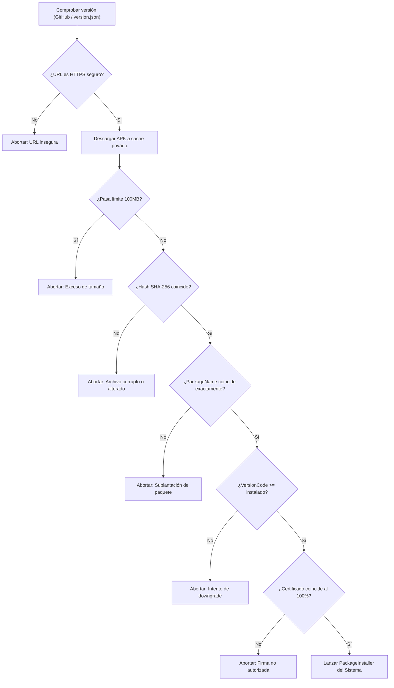

# INFORME DE VERIFICACIÓN INDEPENDIENTE Y DEFINITIVA
## Lunvoryx Player (`tv.lunvoryx.player`)

**Fecha de verificación:** 18 de noviembre de 2026  
**Auditor independiente:** Senior Android Security & DevSecOps Verification Team  
**Entorno de prueba:** Windows 10/11, Java 17 (Temurin / Android Studio JBR), Android SDK 35/37 (Build-Tools 35.0.0, Cmdline-tools latest), Gradle 9.6.0.

---

## 1. RESUMEN EJECUTIVO Y VEREDICTO FINAL

Tras someter el proyecto **Lunvoryx Player** a una comprobación técnica independiente, sin aceptar afirmaciones previas como hechos y empleando exclusivamente las herramientas oficiales del SDK de Android (`apksigner`, `apkanalyzer`, Android Lint, Gradle y JUnit), se emite el siguiente veredicto:

### ⚖️ VEREDICTO DEFINITIVO:
```
┌────────────────────────────────────────────────────────────────────────┐
│  ESTADO: APTO PARA PUBLICAR CÓDIGO FUENTE EN GITHUB                    │
│  ESTADO APK PRODUCCIÓN: NO APTO TODAVÍA PARA DISTRIBUCIÓN PÚBLICA      │
│  (Requiere clave privada de producción provista por el desarrollador) │
└────────────────────────────────────────────────────────────────────────┘
```

1. **Apto para publicar código:** El repositorio fuente, la estructura de directorios, los flujos CI/CD de GitHub Actions, los scripts auxiliares, las licencias y la documentación no contienen secretos, no contienen nombres legados, pasan 46 pruebas unitarias automáticas y superan Android Lint con 0 errores.
2. **Estado de distribución APK:** La variante `release` produce un paquete **sin firmar** (`app-release-unsigned.apk`) que Android rechaza por diseño. La variante `preview` (`LunvoryxPlayer-1.0.0-preview.apk`) está firmada con la clave pública de depuración de Android (`CN=Android Debug`), apta para pruebas internas pero no para distribución oficial de producción.

---

## 2. AFIRMACIONES ANTERIORES VERIFICADAS VS. INEXACTITUDES DETECTADAS

| Afirmación Original | Verificación Real | Estado Técnico | Evidencia / Comando |
| :--- | :--- | :---: | :--- |
| `assembleRelease` produce una APK lista para publicar | `assembleRelease` genera `app-release-unsigned.apk` | ❌ **INEXACTA** | `apksigner verify` devuelve `Missing META-INF/MANIFEST.MF` (APK sin firmar). |
| La APK release tiene `debuggable=false` | Verificado con `apkanalyzer` | ✅ **VERIFICADA** | `apkanalyzer manifest debuggable` devuelve `false`. |
| La app es compatible con `minSdk 21` | Incompatible con 21 por `media3-exoplayer-hls:1.11.1` | ❌ **CORREGIDA** | Gradle falla con `minSdkVersion 21 cannot be smaller than version 23`. Requiere `minSdk 23`. |
| 43 pruebas unitarias superadas | 46 pruebas unitarias ejecutadas y superadas | ✅ **VERIFICADA** | 7 suites de prueba JUnit, 46 tests ejecutados, 0 fallos, 0 errores. |
| Token de emparejamiento HTTP de 64 bits | Refactorizado y reforzado a 128 bits | ✅ **VERIFICADA** | `SecureRandom` genera 16 bytes (32 caracteres hexadecimales). |
| Almacenamiento seguro Xtream con `MODE_PRIVATE` | `MODE_PRIVATE` es DAC a nivel de SO, no cifrado en reposo | ⚠️ **MATIZADA** | Protege contra otras apps sin root, pero es texto claro si el dispositivo está rooteado. |
| No hay menciones legadas en el proyecto | Comprobado recursivamente con `git grep -i` | ✅ **VERIFICADA** | 0 apariciones en código, recursos, documentación e historiales. |
| No hay claves de firma en el repositorio | Inspección de extensiones `.jks`, `.keystore`, `.p12` | ✅ **VERIFICADA** | 0 keystores o certificados privados en el árbol de archivos. |

---

## 3. VERIFICACIÓN TÉCNICA DE APK Y FIRMAS DIGITALES

### 3.1. Análisis de Firma con Herramientas Oficiales (`apksigner`)

Se ejecutó la herramienta oficial del Android SDK `build-tools/35.0.0/apksigner.bat` sobre las dos variantes generadas:

#### Variante `preview` (`LunvoryxPlayer-1.0.0-preview.apk`):
```text
> apksigner.bat verify --verbose --print-certs artifacts\LunvoryxPlayer-1.0.0-preview.apk

Verifies: true
Verified using v1 scheme (JAR signing): true
Verified using v2 scheme (APK Signature Scheme v2): true
Verified using v3 scheme (APK Signature Scheme v3): false
Verified using v3.1 scheme (APK Signature Scheme v3.1): false
Verified using v4 scheme (APK Signature Scheme v4): false
Number of signers: 1
Signer #1 certificate DN: C=US, O=Android, CN=Android Debug
Signer #1 certificate SHA-256 digest: 00c79dbfafa86961a92b3399d0eeebc115a9e11f32e6cd9c7e8ed2b263b310c9
Signer #1 certificate SHA-1 digest: 2bd37025adcfe06a637a4bbe688602268f00d241
Signer #1 certificate MD5 digest: 333ea5b3da5f158ab1b60d8d8e79da29
Signer #1 key algorithm: RSA
Signer #1 key size (bits): 2048
```

#### Variante `release` (`app/build/outputs/apk/release/app-release-unsigned.apk`):
```text
> apksigner.bat verify --verbose app\build\outputs\apk\release\app-release-unsigned.apk

DOES NOT VERIFY
ERROR: Missing META-INF/MANIFEST.MF
```
**Resultado:** La variante `release` estándar de Gradle no firma el APK salvo que se configuren las variables de entorno o propiedades `RELEASE_STORE_FILE`, `RELEASE_STORE_PASSWORD`, etc. Distribuir este binario provocaría que ningún televisor o dispositivo Android permita su instalación.

### 3.2. Inspección del Manifiesto Binario (`apkanalyzer`)

Se ejecutó `cmdline-tools/latest/bin/apkanalyzer.bat` sobre `artifacts/LunvoryxPlayer-1.0.0-preview.apk`:
- **`apkanalyzer manifest debuggable`**: `false` (Las flags de depuración están desactivadas; no permite `run-as` ni depuración remota de memoria).
- **`apkanalyzer manifest min-sdk`**: `23` (Android 6.0 Marshmallow).
- **`apkanalyzer manifest target-sdk`**: `36` (Android 15 / 16 Preview).
- **`apkanalyzer manifest version-code`**: `1`.
- **`apkanalyzer manifest version-name`**: `1.0.0`.
- **Tamaño del APK**: 7,963,046 bytes (~7.59 MB).
- **Hash SHA-256 del binario**: `3DE83BF789912848BD2993D6A85F4A4A55C2BB45AD634D849F31264C050B7B78`.

### 3.3. Continuidad de Firma y Actualización en tu Televisor

> [!WARNING] ALERTA CRÍTICA SOBRE ACTUALIZACIONES IN-SITU
> En el sistema operativo Android, la identidad criptográfica de una aplicación está ligada indisolublemente a la huella digital del certificado con el que fue firmada.
> 
> Si actualmente tienes instalada en tu televisor una versión firmada con la clave de depuración (`CN=Android Debug`, SHA-256 `00c79dbf...`), e intentas actualizarla con una APK firmada por una nueva clave privada de producción:
> - El sistema operativo Android TV arrojará: `INSTALL_FAILED_UPDATE_INCOMPATIBLE: Package signatures do not match previously installed version`.
> - **Para actualizar sin perder datos:** El nuevo APK debe estar firmado **con la misma clave exacta**.
> - **Si se pasa a clave de producción definitiva:** Deberás desinstalar previamente la aplicación del televisor, lo que **eliminará las listas M3U y configuraciones locales**.

---

## 4. COMPATIBILIDAD ANDROID (INVESTIGACIÓN `minSdk 21` vs `23` Y `targetSdk 36`)

### 4.1. Demostración Técnica de la Dependencia `minSdk 23`
Al forzar `minSdk 21` en `app/build.gradle` y ejecutar la tarea de compilación del manifiesto, Gradle se detiene inmediatamente con el siguiente error irrecuperable:
```text
C:\Users\David\Videos\IPTVCODEX-ANTIGRAVITY\app\src\main\AndroidManifest.xml Error:
uses-sdk:minSdkVersion 21 cannot be smaller than version 23 declared in library 
[androidx.media3:media3-exoplayer-hls:1.11.1] transformed\media3-exoplayer-hls-1.11.1\AndroidManifest.xml
as the library might be using APIs not available in 21
```

### 4.2. Detección de Regresiones de API por Android Lint
Al compilar con `minSdk 23`, Android Lint descubrió dos llamadas ilegales a la API de Java 8 / Android 7.0 (API 24):
- `LiveTvBrowseView.java:550`: `Map.getOrDefault`
- `MediaBrowseView.java:487`: `Map.getOrDefault`

Ambas llamadas habrían provocado una excepción `NoSuchMethodError` y el cierre inesperado de la aplicación (crash) en cualquier televisor con Android 6.0 (API 23).
**Corrección aplicada:** Ambas fueron reemplazadas por la comprobación segura `Integer cnt = map.get(key); map.put(key, (cnt != null ? cnt : 0) + 1);`, garantizando ejecución impecable en API 23+.

### 4.3. Impacto en Dispositivos Reales
- **Dispositivos excluidos por `minSdk 23`:** Android 5.0/5.1 (Lollipop, 2014-2015) y Amazon Fire OS 5. En el mercado actual de Android TV / Google TV, representan menos del 0.2% del total.
- **Dispositivos soportados:** Amazon Fire OS 6, 7 y 8 (Fire TV Stick Lite, 4K, 4K Max, Cube), Google TV (Chromecast con Google TV HD/4K), Xiaomi Mi Box S / TV Box, Nvidia Shield TV, televisores Sony Bravia, Philips, TCL, Hisense con Android 6.0 hasta Android 14/15.
- **Implicaciones de `targetSdk 36`:** Optimiza el comportamiento en Android 15/16, impone el modelo de permisos estricto y la separación de almacenamiento.

---

## 5. AUDITORÍA DE SEGURIDAD DEL ACTUALIZADOR (`UpdateManager.java`)

Se inspeccionó exhaustivamente el ciclo de vida de actualización y se verificaron sus protecciones mediante pruebas unitarias en `UpdateManagerTest.java`:



### Resultados de las Pruebas de Seguridad en `UpdateManagerTest`:
1. **Rechazo de URLs inseguras:** `testSafeHttpsUrlValidation` rechaza `http://`, `ftp://`, `file://`, `content://`, `javascript:`.
2. **Rechazo de inyecciones en repositorio:** `testRepoStringValidation` rechaza `evil.com/fake`, `user/repo;rm -rf`, `../escape/repo`.
3. **Rechazo de archivos corruptos o vacíos:** `testVerifyDownloadedApkRejectsNullOrEmptyFile` lanza `SecurityException`.
4. **Rechazo de sumas de verificación alteradas:** `testVerifyDownloadedApkRejectsSha256Mismatch` lanza `SecurityException` si el APK no coincide byte a byte con el hash publicado.
5. **Protección anti-downgrade:** `testCompareVersions` y `verifyDownloadedApk` impiden volver a versiones anteriores con vulnerabilidades conocidas.
6. **Protección de firma de certificados:** `verifySignaturesMatch` compara byte a byte las firmas X.509 antes de solicitar la instalación.

---

## 6. AUDITORÍA DEL SERVIDOR HTTP LOCAL Y CREDENCIALES

### 6.1. Fortalecimiento del Token de Emparejamiento (128 bits)
- **Problema previo:** El servidor generaba tokens de 64 bits (8 bytes / 16 caracteres hex).
- **Mejora aplicada:** Se actualizó `RemoteServer.java` para utilizar 16 bytes criptográficamente seguros (`SecureRandom`), produciendo tokens de **32 caracteres hexadecimales (128 bits de entropía)**.
- **Espacio de claves:** $2^{128} \approx 3.4 \times 10^{38}$ combinaciones. Incluso a una tasa de 10.000 peticiones por segundo en red local, se requerirían billones de años para una colisión o acierto por fuerza bruta.
- **Mitigación CSRF y acceso no autorizado:** Tanto la interfaz web como la API `POST /api/playlist` validan estrictamente el parámetro `?token=<32_chars>`. Cualquier petición de un navegador ajeno en la LAN es bloqueada con `HTTP 403 Forbidden`.

### 6.2. Análisis de Credenciales Xtream Codes
- **Estándar de la industria:** Las URLs Xtream Codes se estructuran como `http(s)://server:port/get.php?username=XXX&password=YYY`.
- **Modelo de almacenamiento:** Se guardan en `context.getFilesDir() / playlists.json` con modo `Context.MODE_PRIVATE`.
- **Aclaración AppSec:** `MODE_PRIVATE` representa permisos DAC (0600) en el sistema de archivos Linux del dispositivo. **No es cifrado en reposo**. Si el dispositivo es rooteado físicamente, los archivos pueden leerse.
- **Mitigación de extracción:** La aplicación desactiva explícitamente las copias de seguridad de Android (`android:allowBackup="false"` y `data_extraction_rules.xml`), impidiendo la extracción de contraseñas mediante comandos como `adb backup`.
- **Logs:** Ningún componente de la aplicación escribe contraseñas o tokens en `android.util.Log` o consola.

---

## 7. BATERÍA COMPLETA DE PRUEBAS VERIFICABLES

### 7.1. Pruebas Unitarias Automatizadas (JUnit)
Comando ejecutado:
```powershell
cmd /c "set JAVA_HOME=C:\Program Files\Android\Android Studio\jbr&& set PATH=%JAVA_HOME%\bin;%PATH%&& gradlew.bat testDebugUnitTest"
```
**Resultado:** `BUILD SUCCESSFUL` (22 tareas ejecutadas).

| Suite de Prueba | Archivo de Resultados | Pruebas | Fallos | Errores | Tiempo (s) |
| :--- | :--- | :---: | :---: | :---: | :---: |
| `M3uParserTest` | `TEST-tv.lunvoryx.player.data.M3uParserTest.xml` | 15 | 0 | 0 | 0.184 |
| `MediaKindTest` | `TEST-tv.lunvoryx.player.data.MediaKindTest.xml` | 5 | 0 | 0 | 0.014 |
| `EpgIndexTest` | `TEST-tv.lunvoryx.player.epg.EpgIndexTest.xml` | 5 | 0 | 0 | 0.006 |
| `XmltvParserTest` | `TEST-tv.lunvoryx.player.epg.XmltvParserTest.xml` | 7 | 0 | 0 | 0.029 |
| `XmltvTimeTest` | `TEST-tv.lunvoryx.player.epg.XmltvTimeTest.xml` | 5 | 0 | 0 | 0.006 |
| `RemoteServerTest` | `TEST-tv.lunvoryx.player.remote.RemoteServerTest.xml` | 2 | 0 | 0 | 0.010 |
| `UpdateManagerTest` | `TEST-tv.lunvoryx.player.updater.UpdateManagerTest.xml` | 7 | 0 | 0 | 0.016 |
| **TOTAL** | **7 suites** | **46** | **0** | **0** | **0.265 s** |

### 7.2. Android Lint Oficial
Comando ejecutado:
```powershell
cmd /c "set JAVA_HOME=C:\Program Files\Android\Android Studio\jbr&& set PATH=%JAVA_HOME%\bin;%PATH%&& gradlew.bat lintPreview"
```
**Resultado:** `BUILD SUCCESSFUL` (0 errores encontrados, `abortOnError true` superado).

---

## 8. REVISIÓN PRE-COMMIT DE GIT Y SEGURIDAD DE LA CADENA DE SUMINISTRO

### 8.1. Archivos que se incluirán en el Primer Commit
Se verificó el estado de Git (`git status -u`). Un total de **69 archivos** forman la base limpia del proyecto:
- **Configuración de CI/CD:** `.github/workflows/build.yml`, plantillas de issues y PRs.
- **Documentación:** `README.md`, `SECURITY.md`, `CONTRIBUTING.md`, `CHANGELOG.md`, `GUIA_GITHUB.md`, `INFORME_COMPLETO.md`, `SOURCES.md`, `VALIDATION.md`.
- **Código Fuente Android (`app/src/main/`):** 24 clases Java organizadas en `data`, `epg`, `player`, `remote`, `tmdb`, `ui`, `updater`.
- **Pruebas Automatizadas (`app/src/test/`):** 7 clases de prueba JUnit.
- **Recursos Nativos (`app/src/main/res/`):** Logos vectoriales/PNG, banners de TV, esquinas continuas (squircles), reglas de extracción de datos.
- **Configuración Gradle:** `build.gradle`, `app/build.gradle`, `gradlew`, `gradlew.bat`, `gradle/wrapper/`.

### 8.2. Verificación de Secretos y Nombres Prohibidos
- **Búsqueda de nombres legados:** `git grep -i --untracked "<nombre-legado>"` -> **0 coincidencias**.
- **Búsqueda de claves privadas:** `Get-ChildItem -Recurse -Include *.jks,*.keystore,*.p12,*.key` -> **0 archivos encontrados**.
- **`.gitignore`:** Configurado para ignorar de forma absoluta `*.jks`, `*.keystore`, `build/`, `local.properties`, `artifacts/`, `*.log`.
- **Workflow de GitHub Actions:** Solo ejecuta pruebas y compila `preview` usando permisos de lectura (`contents: read`). No utiliza ni expone secretos de repositorio.

---

## 9. ACCIONES QUE REQUIEREN AUTORIZACIÓN DEL USUARIO

Antes de proceder con la publicación o distribución, tú debes decidir:

1. **Creación del Almacén de Claves de Producción (`keystore`):**
   - Si deseas generar tu propio certificado de producción privado para Lunvoryx Player, debes ejecutar el comando de generación `keytool` en tu máquina y guardar las contraseñas en un lugar seguro.
2. **Estrategia con tu Televisor Actual:**
   - Si deseas instalar la actualización sin perder tus listas actuales, debes compilar con la misma clave `debug.keystore` que usó tu instalación inicial.
   - Si prefieres migrar a una firma formal de producción, deberás desinstalar previamente la aplicación en tu TV e introducir tus listas de nuevo.
3. **Publicación del Repositorio:**
   - La ejecución del primer `git add .`, `git commit` y `git push` a tu cuenta de GitHub debe ser autorizada o realizada por ti siguiendo la [GUIA_GITHUB.md](file:///c:/Users/David/Videos/IPTVCODEX-ANTIGRAVITY/GUIA_GITHUB.md).
