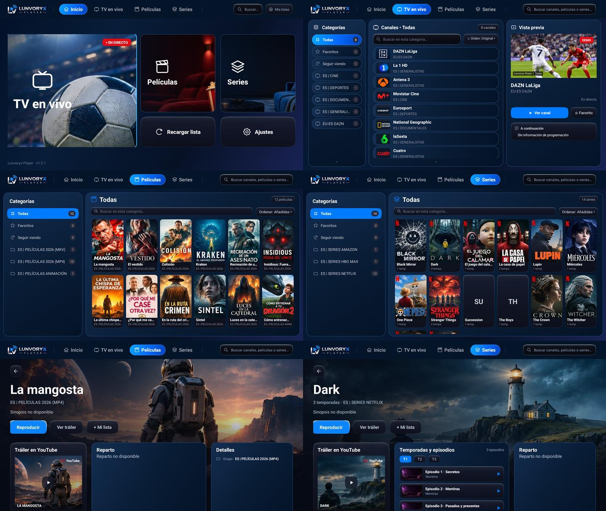

# Lunvoryx Player

Reproductor IPTV nativo para Android TV y Google TV. Permite organizar canales, películas y series, consultar una guía XMLTV y controlar la reproducción con el mando.

## Primeros pasos

1. En **Mis listas**, importa un archivo M3U/M3U8, introduce una URL o configura Xtream. Para hacerlo desde el móvil, conecta ambos dispositivos a la misma red y escanea el QR del televisor.
2. En **Ajustes**, activa **Modo Intuitivo** para usar la barra superior y el mosaico de inicio. El modo clásico ofrece navegación lateral.
3. Abre una biblioteca. La lupa superior busca en todo el catálogo y el buscador de cada categoría filtra sus títulos.

La lista de prueba permite explorar las pantallas y reproducir tres clips locales de 20 segundos sin conexión, uno por tipo de contenido. Para reproducir las emisiones y el contenido de tu proveedor, importa una lista activa.

## El modo Intuitivo con el mando

| Pantalla | Qué puedes hacer |
| --- | --- |
| Inicio | Entrar en TV en vivo, Películas o Series, recargar la lista y abrir Ajustes. |
| TV en vivo | Elegir categoría y canal, consultar el programa actual y el siguiente, ver la vista previa silenciada y abrir el canal a pantalla completa. |
| Películas | Buscar y ordenar carátulas, abrir una ficha, reproducir o añadir una película a favoritos. |
| Series | Elegir una temporada y reproducir un episodio desde su ficha. |
| Ficha | Consultar el reparto y la valoración disponibles. El botón de tráiler abre YouTube y busca el título cuando falta un enlace directo. |

Las flechas desplazan el foco y **OK** activa el control resaltado. **Atrás** permite regresar desde una ficha. Para ver la programación, configura una guía XMLTV que corresponda a los canales. Para completar las fichas con imágenes, reparto y valoración de TMDB, añade tu clave en Ajustes.

Las siguientes capturas se tomaron en el emulador con la lista de prueba. Las ilustraciones de demostración proceden de las referencias visuales del proyecto.



## Compilar y probar en Windows

Configura Java 17 y Android SDK 37. Android Studio puede generar `local.properties` con la ruta del SDK. El Gradle Wrapper incluido permite compilar desde la raíz del proyecto.

```powershell
.\gradlew.bat :app:testDebugUnitTest :app:lintDebug :app:assemblePreview
```

La variante **preview** utiliza R8 y la firma de depuración. Con un televisor o emulador conectado por ADB, instala el APK con este comando.

```powershell
adb install -r app/build/outputs/apk/preview/app-preview.apk
```

La aplicación requiere Android 6.0 (API 23) o posterior. El paquete es `tv.lunvoryx.player`.

## Código y documentación

- [Interfaz y navegación](app/src/main/java/tv/lunvoryx/player/ui) · Pantallas, foco del mando y carga de imágenes.
- [Reproductor](app/src/main/java/tv/lunvoryx/player/player) · AndroidX Media3 y controles de reproducción.
- [Datos](app/src/main/java/tv/lunvoryx/player/data) · Importación, clasificación y persistencia de listas.
- [Contexto del proyecto](CONTEXTO_TOTAL_PROYECTO.md) · Arquitectura y evolución por sesiones.
- [Historial de versiones](CHANGELOG.md) · [Seguridad](SECURITY.md) · [Fuentes y créditos](SOURCES.md).
