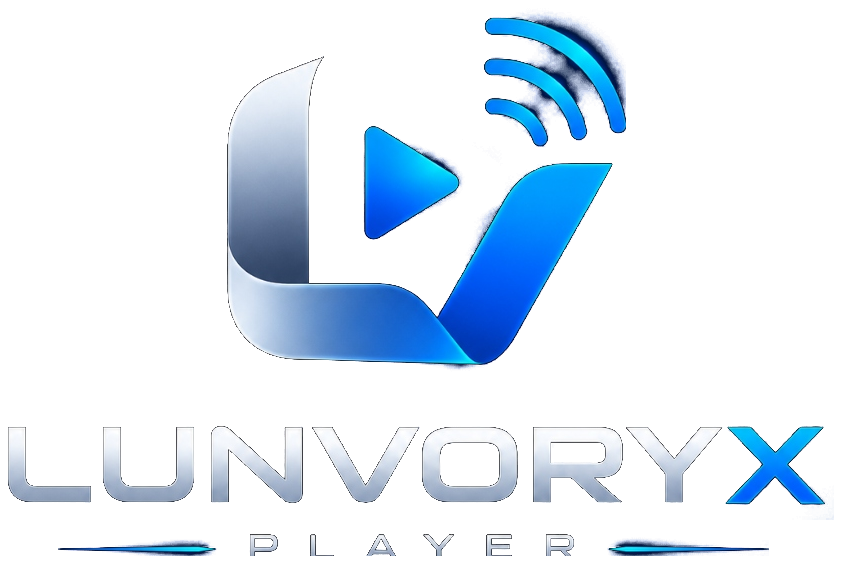
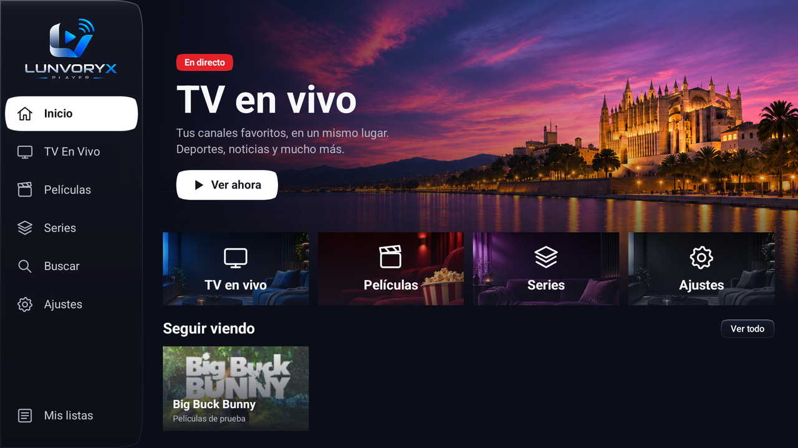
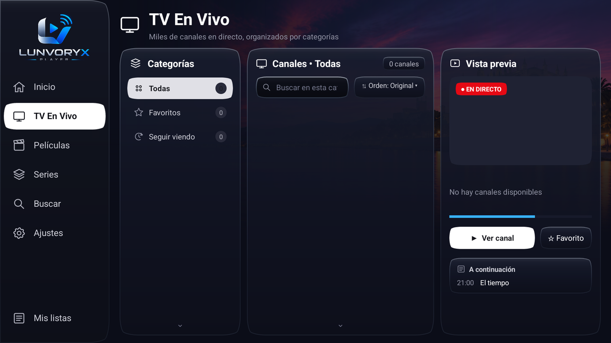
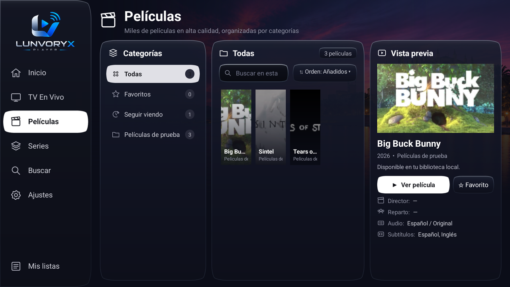
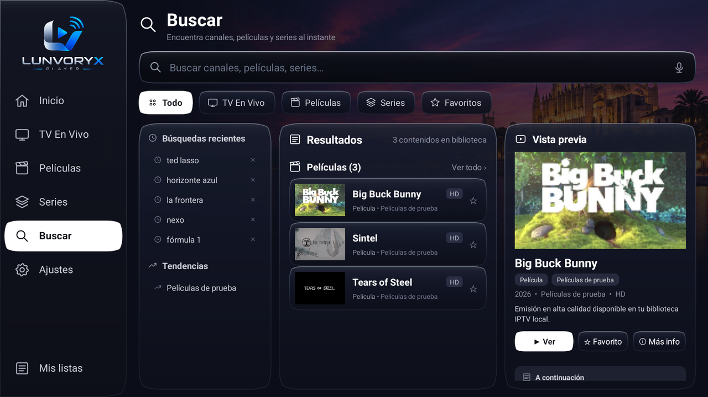
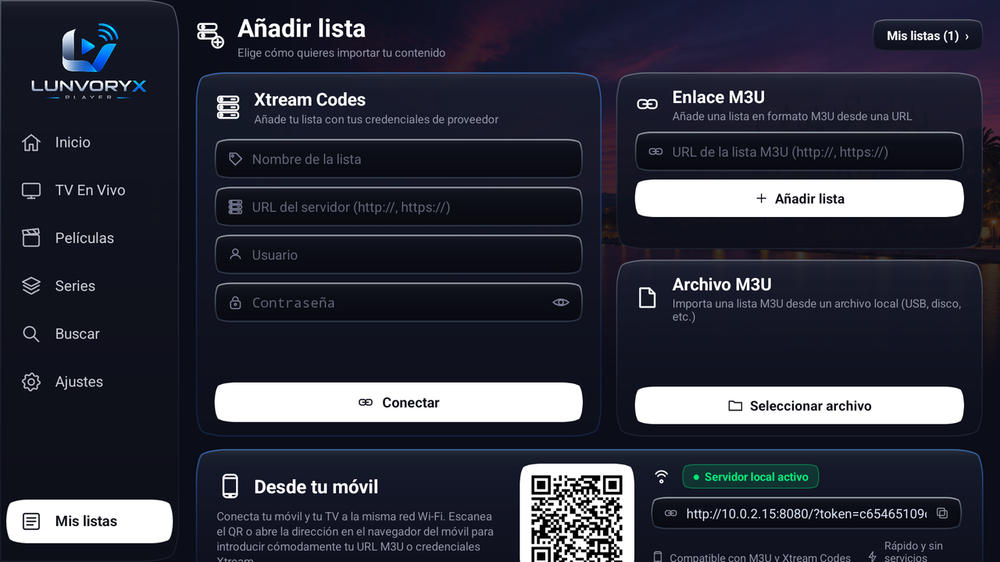
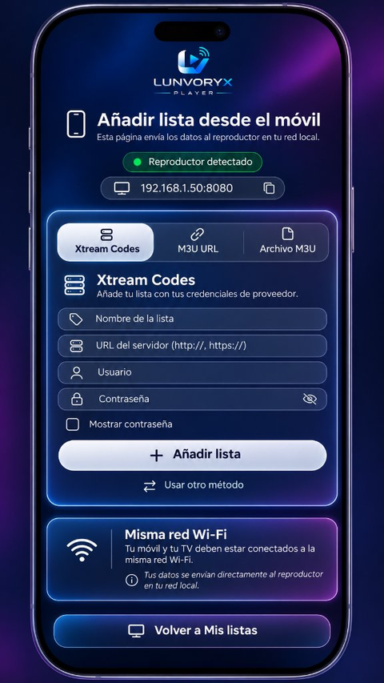

<div align="center">
  
  <h3>Reproductor IPTV Cinematográfico para Android TV, Google TV y Fire OS</h3>
  <p>
    Diseñado específicamente para control remoto (D-Pad). Interfaz nativa inspirada en los estándares de diseño de <b>Apple TV (tvOS)</b>, curvaturas continuas de segundo orden (<i>G² Continuous Squircles</i>), bordes especulares calibrados, importación inalámbrica vía QR y motor multimedia de alto rendimiento <b>AndroidX Media3 (ExoPlayer)</b>.
  </p>
  <p>
    <a href="https://github.com/ilovemygf09/Lunvoryx-Player/releases"></a>
    
    
    
    
  </p>
</div>

---

## Galería Visual

<div align="center">
  
</div>

<br />

| TV En Vivo (3 Columnas con EPG) | Películas y Series (Ficha Cinematográfica) |
|:---:|:---:|
|  |  |

| Búsqueda Instantánea con Filtros | Añadir Lista y Transferencia Móvil |
|:---:|:---:|
|  |  |

<div align="center">
  <h4>Carga Inalámbrica desde el Móvil</h4>
  <p>Escanea el código QR en pantalla y gestiona tus listas M3U o credenciales Xtream cómodamente desde el navegador de tu teléfono.</p>
  
</div>

---

## Características Principales

### 📺 1. Lenguaje Visual Apple tvOS & Curvaturas Continuas ($G^2$ Squircles)
* **Integración Limpia del Isotipo:** Logotipo oficial montado directamente sobre la superficie de vidrio translúcido de la barra lateral, sin recuadros ni fondos superpuestos.
* **Escala de Radios tvOS:** Adiós a las esquinas infladas o artificiales. Sistema de curvaturas proporcional:
  * Barra lateral principal: **22 dp**.
  * Paneles principales de contenido y columnas: **18 dp**.
  * Tarjetas de películas, series y cuadrícula: **12 dp**.
  * Filas de categorías y píldoras de filtrado: **12 dp**.
  * Campos de búsqueda e inputs de texto: **18 dp / 13 dp**.
  * Botones de acción: **12 dp**.
  * Píldora activa del menú: **14 dp**.
* **Física de Materiales y Trazos Hairline:**
  * Trazo de borde cenital especular (*Overhead Rim Light*) con degradado vertical sutil.
  * Bisel óptico interior de profundidad de 20 dp (`0x14FFFFFF` $\to$ `0x00FFFFFF`).
  * Anillo de foco en plata nácar (`0xFFFFFFFF` $\to$ `0xC4D2E0`) con halo difuso de sombra suave (`0x44FFFFFF`).

### 📱 2. Importación Multifuncional y Servidor Local vía QR
* **Desde tu móvil por Wi-Fi:** Servidor HTTP multi-hilo local empotrado (`tv.lunvoryx.player.remote.RemoteServer`) en puerto 8080. Al escanear el QR, se abre una aplicación web responsive protegida por tokens criptográficos temporales (`SecureRandom`), límite ampliado de 250 MB (soporte para listas masivas y VOD de hasta 150.000 canales) y apagado automático por inactividad tras 15 minutos.
* **Xtream Codes API:** Soporte nativo para URL de servidor, usuario y contraseña con autogeneración de streams HLS/TS.
* **Enlace M3U / M3U8:** Descarga e importación por URL directa con soporte de cabeceras (`User-Agent`, `Referer`).
* **Archivo Local:** Selección de archivos `.m3u` o `.m3u8` desde almacenamiento interno o memorias USB.

### ⚡ 3. Motor Multimedia AndroidX Media3 (ExoPlayer)
* Compatibilidad total con streaming adaptativo HLS (`.m3u8`), MPEG-DASH (`.mpd`) y flujos de transporte MPEG-TS (`.ts`).
* Conmutación dinámica de pistas de audio multicanal, subtítulos embebidos y perfiles de tasa de bits.
* Reanudación automática y punto de pausa persistente para contenido bajo demanda (VOD).

### 🎬 4. Metadatos Cinematográficos (TMDB)
* Integración con la API de The Movie Database para descargar portadas en alta definición (Backdrops `w1280` y Posters `w500`), argumentos en español e inglés, géneros, reparto y año de estreno.
* Almacenamiento local con caché inteligente en memoria y disco.

### 📅 5. Guía Electrónica de Programación (EPG / XMLTV)
* Descarga e indexación de guías XMLTV (archivos directos o comprimidos `.xml.gz`).
* Visualización en tiempo real del programa en emisión (*Ahora*) y siguiente emisión (*A continuación*), con barra de progreso temporal de alta precisión.

### 🛡️ 6. Actualizaciones Remotas Seguras (OTA vía GitHub Releases)
* Comprobación automática al iniciar la app o manual desde Ajustes contra las Releases públicas de GitHub.
* Verificación criptográfica obligatoria: compara la firma digital del APK descargado con el certificado de la app instalada antes de solicitar la instalación, protegiendo al usuario contra sustituciones no autorizadas y ataques de degradación (*anti-downgrade*).

---

## Especificaciones del Sistema

| Parámetro | Valor |
| :--- | :--- |
| **Plataformas** | Android TV, Google TV, Fire OS |
| **Entorno de Ejecución** | Java 17 |
| **Gradle / AGP** | Gradle 9.6.0 / AGP 9.4.1 |
| **Target SDK / Compile SDK** | SDK 36 (Android 14) / SDK 37 (Android 15+) |
| **Min SDK** | SDK 23 (Android 6.0 Marshmallow o superior) |
| **Paquete Oficial** | `tv.lunvoryx.player` |
| **Pruebas Automatizadas** | 46 pruebas unitarias JUnit (100% éxito) |

---

## Compilación en Local

1. Requiere JDK 17 o superior configurado en `JAVA_HOME`.
2. Configura tu ruta del SDK de Android en `local.properties` (ej: `sdk.dir=C:/Users/TU_USUARIO/AppData/Local/Android/Sdk`).
3. Ejecuta desde la terminal:

```powershell
# Ejecutar la suite completa de 46 pruebas unitarias
.\gradlew.bat testDebugUnitTest

# Análisis estático de código con Android Lint
.\gradlew.bat lintPreview

# Compilar APK Preview optimizado (ofuscación R8 activa)
.\gradlew.bat assemblePreview

# Compilar APK Release oficial (requiere firma en gradle.properties)
.\gradlew.bat assembleRelease
```

El APK de vista previa se genera en:  
`app/build/outputs/apk/preview/app-preview.apk`

---

## Mando a Distancia (D-Pad)

| Tecla / Botón | Función en Biblioteca | Función durante la Reproducción |
| :--- | :--- | :--- |
| **OK / Centro** | Selecciona o abre contenido | Muestra / Oculta barra de controles |
| **Flechas $\uparrow / \downarrow$** | Navega por filas y categorías | Cambia al canal anterior / siguiente *(controles ocultos)* |
| **Flechas $\leftarrow / \rightarrow$** | Conmuta columnas y tarjetas | Salto de -10 s / +30 s *(en películas y series)* |
| **Atrás (Back)** | Vuelve al menú lateral | Oculta controles o sale al catálogo |

---

## Seguridad y Privacidad

* **100% Libre de Telemetría:** Lunvoryx Player no recopila, rastrea ni envía datos de navegación, listas ni hábitos de visualización a servidores externos.
* **Almacenamiento Local Aislado:** Todas las listas y credenciales se guardan de forma privada en el almacenamiento interno de la app (`Context.MODE_PRIVATE`).
* **Verificación de Vulnerabilidades:** Consulta nuestra [Política de Seguridad (SECURITY.md)](SECURITY.md).
* **Novedades de Versión:** Consulta el [Registro de Cambios (CHANGELOG.md)](CHANGELOG.md).
* **Créditos y Recursos Libres:** Consulta [Fuentes y Procedencia (SOURCES.md)](SOURCES.md).
